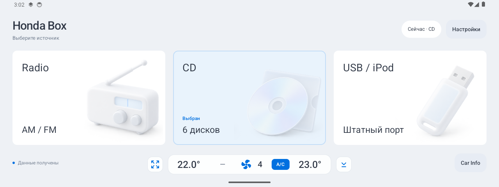
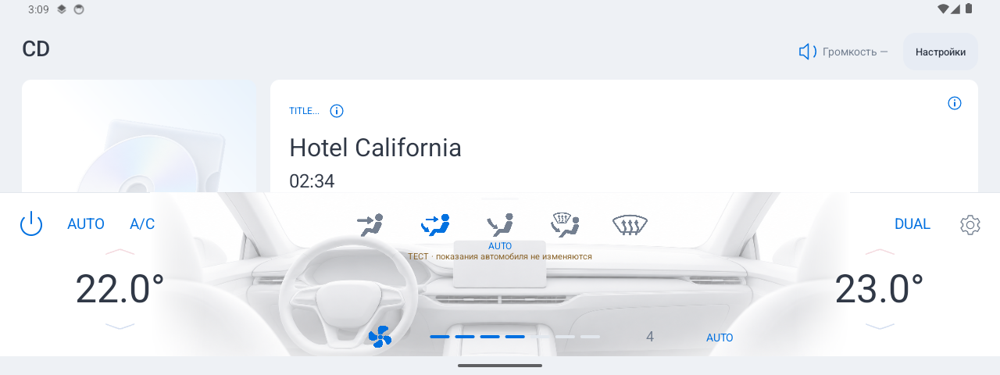

# Honda Box

An Android companion for Honda's original audio and climate system on FYT head units with a BSJ CAN adapter. Native Java, built without Gradle or a cloud service. [Русский](README.ru.md).

Developed against **Honda Accord VIII / Spirior 2009–2013**, FYT profile **6291908**, and BSJ V704. Compatibility with other profiles is not assumed. Requires **Android 7.0 / API 24+**. The main package is `com.crewbeat.hondabox`.



*Emulator preview with synthetic values.*

## Features

- Radio, CD and a shared USB/iPod player for the **original Honda media ports**, with source-aware icons and metadata.
- FM1/FM2, AM1/MW and AM2/LW; frequencies, six presets, stereo/status and selected station. CD shows six discs and the current selection.
- A full-width climate popup and a persistent compact climate strip, with folding, side controls, independent settings and day/night artwork.
- Top overlays for source, volume and track/station changes. Tapping a track announcement opens its source screen.
- OEM menu display, contextual lists, current TITLE field and source-specific player help.
- Day, night, Android system theme, or automatic sunrise/sunset mode; accent presets/custom color; English/Russian/system language.
- Headless service start, boot/wake reconnection and optional automatic player opening when the app is in the background.
- Optional stock CANBUS overlay suppression through Shizuku, with restoration of the previous AppOps state.
- Debug screen, opt-in recording, export, BSJ packet analysis and manually triggered command experiments.



## Data and limitations

The service reads FYT Binder callbacks and adapter packets exposed by MainServer. These **BSJ packets are not a confirmed raw Honda CAN-ID/DLC stream**. There is no direct UART connection in this app.

USB/iPod detection includes observed adapter markers and inference for this profile; it is not a universal hardware flag. TITLE text is kept as the combined field actually supplied by the car. Missing or corrupted characters cannot be recovered. OEM audio power on/off is supported. Climate controls are displayed rather than sent to the car; unsupported recirculation/rear-defrost indicators are omitted. RDS settings are displayed, but station-name/RadioText transmission is not confirmed for this adapter. Car Info remains experimental: trip values are not presented as decoded when their meaning is unverified. Audio-command support depends on firmware; use the car controls where required.

## Install and start

Build or obtain the main APK and companion launchers from a release you trust. This repository does not include release APKs or a signing key.

1. Install the main `Honda-Box-<version>.apk`.
2. Install **Honda Box**, **Radio**, **CD** and **USB** launcher APKs as needed. One USB launcher covers both USB and iPod.
3. Open Honda Box, allow **display over other apps**, and configure the large/compact climate panels independently.
4. Confirm the head unit uses profile 6291908. Allow foreground/background operation; add Honda Box to DUDU's keep-alive list if needed.
5. Optional: install/start [Shizuku](https://shizuku.rikka.app/guide/setup/) via ADB and grant Honda Box access to manage the stock overlay setting.

The service icon starts headlessly. The separate Honda Box launcher opens the selector. Location is only needed for sunrise/sunset setup. Logging is off by default and can be enabled/reset in Debug. The app cannot guarantee survival of vendor task killers.

## Package identifiers

| App | Android package |
| --- | --- |
| Honda Box Service | `com.crewbeat.hondabox` |
| Honda Box selector launcher | `com.crewbeat.hondabox.launcher` |
| Radio launcher | `com.crewbeat.hondabox.radio` |
| CD launcher | `com.crewbeat.hondabox.cd` |
| USB/iPod launcher | `com.crewbeat.hondabox.usb` |

The new identifiers install separately from the old `dev.alex.fyt.probe` app and its launchers. This is not an in-place upgrade; Android does not transfer the old app's preferences or permissions automatically. The optional legacy iPod launcher source is not part of the standard build; the shared USB launcher is sufficient.

## Build

Python 3.9+, a JDK (17+ recommended), and an installed Android SDK are required. The build uses **platform android-33** and **Build Tools 36.0.0**. Install those SDK packages with Android Studio or `sdkmanager`; no dependency downloads occur during the build. Shizuku/AndroidX libraries are vendored with their licenses and checksums.

```sh
export ANDROID_SDK_ROOT="$HOME/Library/Android/sdk"  # use your SDK path
export JAVA_HOME="/path/to/your/jdk"
python3 build.py
python3 build_launchers.py
```

On macOS, the scripts also detect Android Studio's bundled JDK. Other systems can use `JAVA_HOME` or the JDK on PATH. APKs and SHA-256 files go to **dist/**; intermediate files go to **build/**. The application/launcher versions are read from their manifests.

| Variable | Purpose |
| --- | --- |
| `ANDROID_SDK_ROOT` / `ANDROID_HOME` | SDK directory |
| `JAVA_HOME` | JDK directory |
| `ANDROID_BUILD_TOOLS` | Build Tools version (default 36.0.0) |
| `ANDROID_COMPILE_SDK` | Compile API (default 33) |
| `HONDA_BUILD_DIR`, `HONDA_OUTPUT_DIR` | Override build/output locations |
| `HONDA_KEYSTORE`, `HONDA_KEYSTORE_PASSWORD` | Existing signing key and password |

A fresh checkout creates an ignored local development key under `.local/signing/`. The owner's existing local signing key is preserved for future builds. **An APK signed with a different key cannot update an existing installation.** Keep the original key outside Git and use the signing variables for release builds. Locally generated development builds are not official releases.

## Tests

Portable checks using synthetic data:

```sh
python3 -m unittest discover -s tools -p 'test_*.py'
python3 tests/run_solar_tests.py
python3 build_tests.py
```

`build_tests.py` compiles the test runner and a **test-only FYT fixture**; it never installs them. See [testing](docs/testing.md) for emulator-only installation and standalone suites. Real vehicle captures and legacy replay assets are deliberately excluded from Git. The legacy broad replay suite requires those local captures; the documented standalone suites and host checks do not. Emulator samples are synthetic, and hardware checks are separate.

## Repository layout

```text
src/                 Android service, model, packet decoder and native UI
res/, assets/        Resources, generated artwork and bundled license notices
launchers/           Honda Box / Radio / CD / USB companion launchers
third_party/         Vendored Shizuku/AndroidX dependencies and licenses
tests/               Synthetic host checks, emulator runner and fixture
tools/              Log decoder and stock-overlay ADB helper
docs/               Architecture, testing and publishing notes
```

See [architecture](docs/architecture.md), [publishing](docs/publishing.md), and [contributing](CONTRIBUTING.md). The source currently includes UI changes after the last local 0.8.29 release; no newer release is implied by this repository preparation.

## License

Author-created code is licensed under [MIT](LICENSE). Dependency licenses and illustration provenance are documented in [NOTICE.md](NOTICE.md). Personal captures, signing keys, OEM firmware, decompiled applications, historical APKs and build outputs are excluded from the Git tree.
